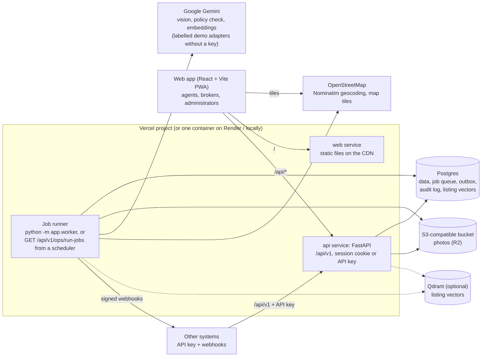

# Architecture

A modular monolith: one FastAPI API, one React web app, one Postgres database, and a background job worker that runs from the same code. Decisions and their reasons are in `docs/decisions/` (ADRs 0001 to 0007).

## System



- **Requests** reach `/api/v1`. Browsers sign in with an httpOnly session cookie; other systems use scoped, rate-limited API keys (`docs/api/developer-guide.md`). Every tenant-scoped request acts in one organisation (`X-Organisation-ID`), and permissions come from the member's role in it (`docs/security/rbac-matrix.md`).
- **Slow work never runs in a request.** A request writes a row to the `jobs` table in its own transaction; the job runner claims due jobs with `FOR UPDATE SKIP LOCKED`, retries with backoff, and reclaims jobs whose runner died (ADR 0003). Listing changes also write an **outbox** event in the same transaction, which feeds search indexing and webhooks, so no change is lost between the database and the index.
- **AI is behind interfaces** (`ai/providers.py`, `compliance/providers.py`, `search/embedder.py`, `geo/geocoder.py`). Without keys each has a labelled demo adapter, so the whole app runs offline. AI output is always a suggestion a person decides on; it never writes agent-entered fields.
- **Audit log:** every change of consequence writes an `audit_events` row with the actor, organisation, target and request ID.

## Modules

`services/api/app/modules/<name>/` holds each module's `models.py`, `schemas.py`, `service.py` and `router.py`. A module reads another module's data only through that module's `service`.

| Module | Owns |
|---|---|
| `auth` | Users, sessions, password reset, sign-in rate limit |
| `organisations` | Organisations, memberships, roles, invitations, permissions |
| `audit` | Audit log and its filters |
| `listings` | Properties, listings, status lifecycle and publication gate, sharing, search filters |
| `media` | Photos, thumbnails, signed links, storage (local or S3) |
| `ai` | Vision provider, extraction runs, redaction |
| `review` | Human review of AI suggestions; confirmed features |
| `imports` | CSV import with field mapping and provenance |
| `compliance` | Policy packs, word rules plus AI check, findings, review queue, appeals |
| `geo` | Geocoding, coordinates, radius and map-area search, neighbourhood data slots |
| `search` | Embeddings, vector store (Postgres or Qdrant), semantic search |
| `outbox` | Transactional outbox events |
| `valuation` | Comparable-sales estimate, days-on-market simulation, accuracy tracking |
| `workflow` | LangGraph listing workflow, runs and steps, cancel and retry |
| `jobs` | Postgres job queue and runner |
| `apikeys` | API keys, scopes, rate limits, usage log, idempotency |
| `webhooks` | Subscriptions, signed deliveries, retries, dead letters |
| `collaboration` | Assignments, comments, private notes, notifications, activity |
| `dashboard` | Role-aware home page numbers |
| `ops` | Service health, alerts, daily cleanup, the HTTP job runner |
| `health` | `GET /api/v1/health` (API and database) |

## Agent workflow (`listing_intake`, version 2)

A LangGraph `StateGraph` in `app/modules/workflow/service.py`. Each run is a row in `workflow_runs` with one `workflow_steps` row per step. The graph runs as background jobs: one pass runs every step that can run now, then queues the next pass while something is still waiting (every 10 seconds, at most 30 minutes).

```mermaid
stateDiagram-v2
    [*] --> geocode: agent clicks "Run workflow"<br/>or the API starts a run
    geocode: Locate the property<br/>(geocoder job)
    extract: Read the photos<br/>(AI extraction run; skipped without photos)
    compliance: Policy check<br/>(word rules + AI check)
    review: Human review<br/>waits for every suggestion and finding to be decided
    index: Add to search<br/>(embedding)
    valuation: Estimate value<br/>(comparable sales)

    geocode --> extract
    extract --> compliance
    compliance --> review
    review --> awaiting_review: something undecided
    awaiting_review --> review: a person decides<br/>(next pass)
    review --> index: all decided
    index --> valuation
    valuation --> [*]: Finished<br/>webhook workflow.finished

    state "Paused: awaiting review" as awaiting_review
```



- **Publication gate:** a listing cannot go from pending review to active while a run is queued, running or awaiting review, or while a policy finding is open (`listings.service.APPROVAL_GUARDS`, checked in the service, not only in the router).
- **Cancel** stops a run; **Retry** keeps finished steps and runs the rest again. A step that raises is tried up to 3 times; a run past its deadline fails with the reason.
- Every step records its status, attempts, output (agent run ID, valuation ID, reason for a skip) and error; the run has a trace ID that appears in the logs.

## Data model (ERD)

Generated from the SQLAlchemy models by `scripts/erd.py`; only primary and foreign keys are shown, every column is in the module's `models.py`. Regenerate after a model change:

```bash
cd services/api && .venv/bin/python ../../scripts/erd.py
```

```mermaid
erDiagram
    api_key_usage {
        uuid id PK
    }
    idempotency_records {
        uuid id PK
    }
    organisations {
        uuid id PK
    }
    users {
        uuid id PK
    }
    api_keys {
        uuid id PK
        uuid organisation_id FK
        uuid created_by_user_id FK
    }
    audit_events {
        uuid id PK
        uuid actor_user_id FK
        uuid organisation_id FK
    }
    auth_sessions {
        uuid id PK
        uuid user_id FK
    }
    invitations {
        uuid id PK
        uuid organisation_id FK
        uuid invited_by_user_id FK
    }
    jobs {
        uuid id PK
        uuid organisation_id FK
    }
    listing_imports {
        uuid id PK
        uuid organisation_id FK
        uuid imported_by_user_id FK
    }
    notification_preferences {
        uuid id PK
        uuid user_id FK
    }
    organisation_memberships {
        uuid id PK
        uuid user_id FK
        uuid organisation_id FK
    }
    outbox_events {
        uuid id PK
        uuid organisation_id FK
    }
    password_reset_tokens {
        uuid id PK
        uuid user_id FK
        uuid created_by_user_id FK
    }
    properties {
        uuid id PK
        uuid organisation_id FK
    }
    review_tasks {
        uuid id PK
        uuid organisation_id FK
    }
    webhook_subscriptions {
        uuid id PK
        uuid organisation_id FK
        uuid created_by_user_id FK
    }
    listings {
        uuid id PK
        uuid organisation_id FK
        uuid property_id FK
        uuid listing_agent_user_id FK
    }
    review_decisions {
        uuid id PK
        uuid task_id FK
        uuid decided_by_user_id FK
    }
    webhook_deliveries {
        uuid id PK
        uuid subscription_id FK
        uuid event_id FK
    }
    agent_runs {
        uuid id PK
        uuid organisation_id FK
        uuid listing_id FK
        uuid requested_by_user_id FK
        uuid job_id FK
    }
    listing_assignments {
        uuid listing_id PK,FK
        uuid user_id FK
        uuid assigned_by_user_id FK
    }
    listing_comments {
        uuid id PK
        uuid organisation_id FK
        uuid listing_id FK
        uuid author_user_id FK
    }
    listing_import_rows {
        uuid id PK
        uuid import_id FK
        uuid organisation_id FK
        uuid listing_id FK
        uuid property_id FK
    }
    listing_status_history {
        uuid id PK
        uuid listing_id FK
        uuid organisation_id FK
        uuid changed_by_user_id FK
    }
    listing_vectors {
        uuid listing_id PK,FK
        uuid organisation_id FK
    }
    media_assets {
        uuid id PK
        uuid organisation_id FK
        uuid listing_id FK
        uuid original_id FK
        uuid uploaded_by_user_id FK
    }
    notifications {
        uuid id PK
        uuid user_id FK
        uuid organisation_id FK
        uuid listing_id FK
    }
    valuations {
        uuid id PK
        uuid organisation_id FK
        uuid listing_id FK
        uuid requested_by_user_id FK
    }
    workflow_runs {
        uuid id PK
        uuid organisation_id FK
        uuid listing_id FK
        uuid requested_by_user_id FK
    }
    listing_features {
        uuid id PK
        uuid organisation_id FK
        uuid listing_id FK
        uuid media_asset_id FK
        uuid created_by_user_id FK
    }
    workflow_steps {
        uuid id PK
        uuid run_id FK
    }
    users ||--o{ api_keys : "created_by_user_id"
    organisations ||--o{ api_keys : "organisation_id"
    users |o--o{ audit_events : "actor_user_id"
    organisations |o--o{ audit_events : "organisation_id"
    users ||--o{ auth_sessions : "user_id"
    users ||--o{ invitations : "invited_by_user_id"
    organisations ||--o{ invitations : "organisation_id"
    organisations |o--o{ jobs : "organisation_id"
    users ||--o{ listing_imports : "imported_by_user_id"
    organisations ||--o{ listing_imports : "organisation_id"
    users ||--o{ notification_preferences : "user_id"
    organisations ||--o{ organisation_memberships : "organisation_id"
    users ||--o{ organisation_memberships : "user_id"
    organisations ||--o{ outbox_events : "organisation_id"
    users ||--o{ password_reset_tokens : "created_by_user_id"
    users ||--o{ password_reset_tokens : "user_id"
    organisations ||--o{ properties : "organisation_id"
    organisations ||--o{ review_tasks : "organisation_id"
    users ||--o{ webhook_subscriptions : "created_by_user_id"
    organisations ||--o{ webhook_subscriptions : "organisation_id"
    users ||--o{ listings : "listing_agent_user_id"
    organisations ||--o{ listings : "organisation_id"
    properties ||--o{ listings : "property_id"
    users ||--o{ review_decisions : "decided_by_user_id"
    review_tasks ||--o{ review_decisions : "task_id"
    outbox_events |o--o{ webhook_deliveries : "event_id"
    webhook_subscriptions ||--o{ webhook_deliveries : "subscription_id"
    jobs |o--o{ agent_runs : "job_id"
    listings ||--o{ agent_runs : "listing_id"
    organisations ||--o{ agent_runs : "organisation_id"
    users ||--o{ agent_runs : "requested_by_user_id"
    users ||--o{ listing_assignments : "assigned_by_user_id"
    listings ||--o{ listing_assignments : "listing_id"
    users ||--o{ listing_assignments : "user_id"
    users ||--o{ listing_comments : "author_user_id"
    listings ||--o{ listing_comments : "listing_id"
    organisations ||--o{ listing_comments : "organisation_id"
    listing_imports ||--o{ listing_import_rows : "import_id"
    listings ||--o{ listing_import_rows : "listing_id"
    organisations ||--o{ listing_import_rows : "organisation_id"
    properties ||--o{ listing_import_rows : "property_id"
    users ||--o{ listing_status_history : "changed_by_user_id"
    listings ||--o{ listing_status_history : "listing_id"
    organisations ||--o{ listing_status_history : "organisation_id"
    listings ||--o{ listing_vectors : "listing_id"
    organisations ||--o{ listing_vectors : "organisation_id"
    listings ||--o{ media_assets : "listing_id"
    organisations ||--o{ media_assets : "organisation_id"
    media_assets |o--o{ media_assets : "original_id"
    users ||--o{ media_assets : "uploaded_by_user_id"
    listings |o--o{ notifications : "listing_id"
    organisations ||--o{ notifications : "organisation_id"
    users ||--o{ notifications : "user_id"
    listings ||--o{ valuations : "listing_id"
    organisations ||--o{ valuations : "organisation_id"
    users ||--o{ valuations : "requested_by_user_id"
    listings ||--o{ workflow_runs : "listing_id"
    organisations ||--o{ workflow_runs : "organisation_id"
    users ||--o{ workflow_runs : "requested_by_user_id"
    users ||--o{ listing_features : "created_by_user_id"
    listings ||--o{ listing_features : "listing_id"
    media_assets |o--o{ listing_features : "media_asset_id"
    organisations ||--o{ listing_features : "organisation_id"
    workflow_runs ||--o{ workflow_steps : "run_id"
```



## API documentation

- Interactive docs (development only): http://localhost:8000/api/v1/docs; the schema at `/api/v1/openapi.json`. Both are off when `ENVIRONMENT=production`.
- `docs/api/developer-guide.md`: API keys, scopes, rate limits, idempotency, webhooks and signatures, with the sample client `examples/mls_client.py` and receiver `examples/webhook_receiver.py`.
- Conventions (error envelope, `X-Organisation-ID`, `version` on edits, cursor pagination): README, "API conventions".
